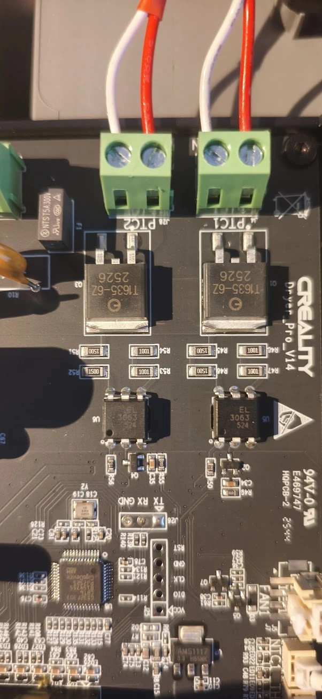
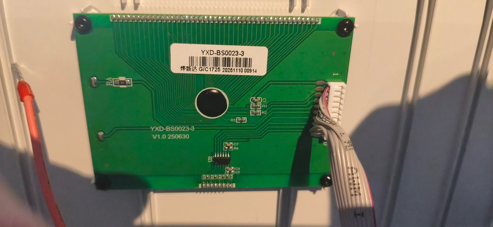

# Hardware of the Creality SpacePi X4L

Applies to the control board **"Creality Dryer_Pro_V14"** with the microcontroller **GigaDevice GD32F303CBT6**
(Cortex-M4, 128 KB flash, 8 MHz crystal). Everything here was measured or tested on a real device.

## Building blocks

| Block | Parts |
|---|---|
| Power supply | isolated AC/DC module (green board) → **12 V**; AMS1117-5.0 → 5 V; AMS1117-3.3 → 3.3 V |
| Heaters | 200 W PTC per chamber, triac T1635-6Z with opto-triac EL3063 (zero crossing) |
| Fans | one 2-wire 12 V fan per chamber, switched by a transistor |
| Sensors | per chamber one NTC on the heater surface (100 kΩ) and one AHT20 (temperature/humidity, I2C) |
| Display | segment LCD "YXD-BS0023-3" with its own driver chip, 4 touch keys, on the 10-pin box header J12 |
| Service | J25 = SWD (5 holes), J26 = UART (3 holes) – pin headers have to be soldered in |

## Pinout GD32F303CBT6

| Pin | LQFP48 | Function | Note |
|---|---|---|---|
| PA0 | 10 | NTC heater **left** | ADC, divider 4.7 kΩ to 3.3 V |
| PA1 | 11 | NTC heater **right** | ADC |
| PA2 | 12 | key **L/R** | active high, internal pull-down |
| PA3 | 13 | key **arrow down** | active high |
| PA4 | 14 | key **arrow up** | active high |
| PA5 | 15 | key **settings (gear)** | active high |
| PA6 | 16 | display (supply/backlight) | high at start |
| **PA9** | 30 | **heater right** | high = on |
| **PA10** | 31 | **heater left** | high = on |
| PB0 | 18 | fan **left** | high = on |
| PB1 | 19 | fan **right** | high = on |
| PB6 | 42 | UART TX → J26 "TX" | USART0, remapped |
| PB7 | 43 | UART RX ← J26 "RX" | USART0, remapped |
| PB10 | 21 | display clock | software 2-wire |
| PB11 | 22 | display data | software 2-wire |
| PB12 / PB13 | 25 / 26 | AHT20 **left**: SCL / SDA | software I2C, address 0x38 |
| PB14 / PB15 | 27 / 28 | AHT20 **right**: SCL / SDA | software I2C, address 0x38 |
| PA13 / PA14 | 34 / 37 | SWD (DIO / CLK) → J25 | |

> ⚠ **PA9/PA10 are the heaters.** The built-in bootloader of the GD32 uses exactly these pins
> (USART0 without remap). That is why the firmware is flashed over SWD only.

## Service headers

**J25 – SWD** (5 pins, labelled on the board): `RST` `GND` `CLK` `DIO` `VCC`
(VCC = 3.3 V of the board). The RST line does not work reliably with OpenOCD, flashing uses a
software reset – RST does not need to be connected.

**J26 – UART** (3 pins): `TX` `RX` `GND`. The labels are from the dryer's point of view:
**TX = dryer sends** (PB6), **RX = dryer receives** (PB7). 3.3 V levels, 115200 baud.

## Display connector J12 (10 pins)

Numbering: top row 1–5 (key notch between 2 and 4), bottom row 6–10.

| Pin | Function |
|---|---|
| 1 | key arrow up |
| 2 | key L/R |
| 3 | **5 V** (always on – the ESP32-C3 is connected here) |
| 4 | display data |
| 5 | 5 V |
| 6 | key settings |
| 7 | key arrow down |
| 8 | GND |
| 9 | display clock (~40–50 kHz) |
| 10 | GND |

## Display protocol

I2C-like, bit-banged on PB10/PB11, address `0x7E`.

- Start: PA6 high, then three commands, each as `7E <command>`: `9C`, `C0`, `72`.
- Frame: `7E 00` + **20 data bytes** (= 160 segments).
- Normal digits use one byte: `0x80` a (top), `0x40` b, `0x20` c, `0x10` d, `0x08` f, `0x04` g,
  `0x02` e, `0x01` a symbol.
- The clock is shifted by half a byte: upper half = f/g/e (+ symbol) of the digit,
  lower half of the next byte = a/b/c/d.
- Byte map: 0/1 target temperature (small), 2–8 clock (+ L, "Time", small °C/°F, key frame,
  colons, left ring), 9/10 humidity, 11/12 big temperature, 13 right ring, R, PV, big °C/°F,
  14–19 material (+ L/R key, ON, AUTO, OFF, "Material").

The complete map of all symbols is in `tools/lcd_frame.py` and `firmware/src/display.h`.

## Sensors

- **AHT20**: measure command `AC 33 00`, result after ~80 ms (status + 5 data bytes + CRC).
- **NTC**: R = 4700 · ADC / (4096 − ADC); curve from Steinhart-Hart (`tools/ntc_table.py`),
  deviation below 0.2 K between −15 and 150 °C.
