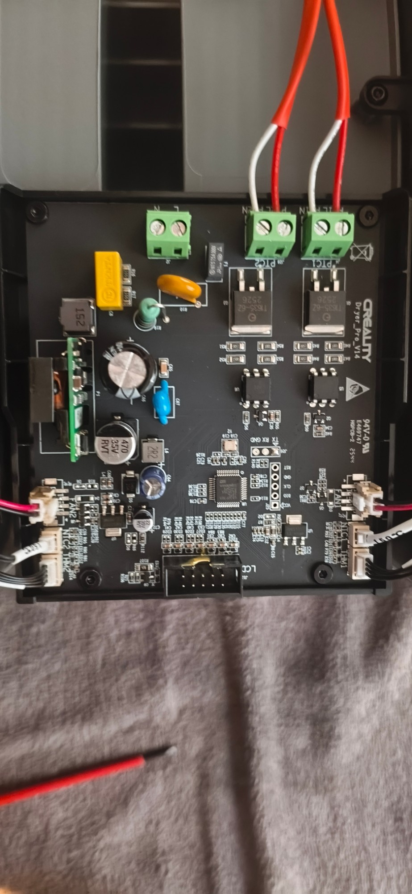
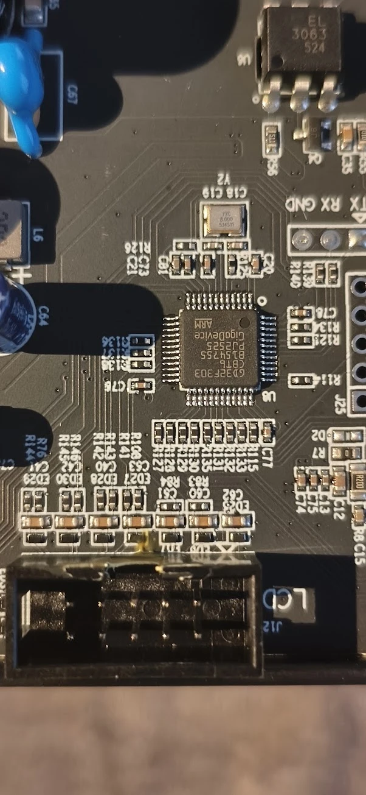

# Hardware des Creality SpacePi X4L

Gilt für die Steuerplatine **„Creality Dryer_Pro_V14“** mit Mikrocontroller **GigaDevice GD32F303CBT6**
(Cortex-M4, 128 KB Flash, 8-MHz-Quarz). Alle Angaben wurden am echten Gerät gemessen bzw. getestet.

## Baugruppen

| Baugruppe | Bauteile |
|---|---|
| Netzteil | isoliertes AC/DC-Modul (grüne Platine) → **12 V**; AMS1117-5.0 → 5 V; AMS1117-3.3 → 3,3 V |
| Heizungen | je Kammer 200 W PTC, Triac T1635-6Z mit Optotriac EL3063 (Nulldurchgang) |
| Lüfter | je Kammer ein 2-poliger 12-V-Lüfter über Transistor |
| Sensoren | je Kammer ein NTC an der Heizfläche (100 kΩ) und ein AHT20 (Temperatur/Feuchte, I2C) |
| Display | Segment-LCD „YXD-BS0023-3“ mit eigenem Treiberchip, 4 Touch-Tasten, über 10-poligen Wannenstecker J12 |
| Service | J25 = SWD (5 Lötlöcher), J26 = UART (3 Lötlöcher) – Stiftleisten müssen eingelötet werden |

## Pinbelegung GD32F303CBT6

| Pin | LQFP48 | Funktion | Bemerkung |
|---|---|---|---|
| PA0 | 10 | NTC Heizung **links** | ADC, Teiler 4,7 kΩ nach 3,3 V |
| PA1 | 11 | NTC Heizung **rechts** | ADC |
| PA2 | 12 | Taste **L/R** | aktiv High, interner Pulldown |
| PA3 | 13 | Taste **Pfeil runter** | aktiv High |
| PA4 | 14 | Taste **Pfeil hoch** | aktiv High |
| PA5 | 15 | Taste **Einstellung (Zahnrad)** | aktiv High |
| PA6 | 16 | Display (Versorgung/Licht) | beim Start High |
| **PA9** | 30 | **Heizung rechts** | High = an |
| **PA10** | 31 | **Heizung links** | High = an |
| PB0 | 18 | Lüfter **links** | High = an |
| PB1 | 19 | Lüfter **rechts** | High = an |
| PB6 | 42 | UART TX → J26 „TX“ | USART0, umgeleitet (Remap) |
| PB7 | 43 | UART RX ← J26 „RX“ | USART0, umgeleitet |
| PB10 | 21 | Display-Takt | Software-2-Draht |
| PB11 | 22 | Display-Daten | Software-2-Draht |
| PB12 / PB13 | 25 / 26 | AHT20 **links**: SCL / SDA | Software-I2C, Adresse 0x38 |
| PB14 / PB15 | 27 / 28 | AHT20 **rechts**: SCL / SDA | Software-I2C, Adresse 0x38 |
| PA13 / PA14 | 34 / 37 | SWD (DIO / CLK) → J25 | |

> ⚠ **PA9/PA10 sind die Heizungen.** Der eingebaute Bootloader des GD32 arbeitet auf genau diesen
> Pins (USART0 ohne Remap). Deshalb wird die Firmware ausschließlich per SWD geflasht.

## Service-Leisten

**J25 – SWD** (5-polig, Beschriftung auf der Platine): `RST` `GND` `CLK` `DIO` `VCC`
(VCC = 3,3 V der Platine). Die RST-Leitung greift mit OpenOCD nicht zuverlässig, geflasht wird per
Software-Reset – RST muss nicht angeschlossen werden.

**J26 – UART** (3-polig): `TX` `RX` `GND`. Die Beschriftung gilt aus Sicht des Trockners:
**TX = Trockner sendet** (PB6), **RX = Trockner empfängt** (PB7). 3,3-V-Pegel, 115200 Baud.

## Display-Stecker J12 (10-polig)

Nummerierung: obere Reihe 1–5 (Kodiernase zwischen 2 und 4), untere Reihe 6–10.

| Pin | Funktion |
|---|---|
| 1 | Taste Pfeil hoch |
| 2 | Taste L/R |
| 3 | **5 V** (Dauerversorgung – hier wird der ESP32-C3 angeschlossen) |
| 4 | Display-Daten |
| 5 | 5 V |
| 6 | Taste Einstellung |
| 7 | Taste Pfeil runter |
| 8 | GND |
| 9 | Display-Takt (~40–50 kHz) |
| 10 | GND |

## Display-Protokoll

I2C-ähnlich per Software an PB10/PB11, Adresse `0x7E`.

- Start: PA6 auf High, dann drei Befehle je als `7E <befehl>`: `9C`, `C0`, `72`.
- Bild: `7E 00` + **20 Datenbytes** (= 160 Segmente).
- Normale Ziffern belegen ein Byte: `0x80` a (oben), `0x40` b, `0x20` c, `0x10` d, `0x08` f, `0x04` g,
  `0x02` e, `0x01` ein Symbol.
- Die Uhrzeit ist um ein halbes Byte versetzt: obere Hälfte = f/g/e (+ Symbol) der Ziffer,
  untere Hälfte des nächsten Bytes = a/b/c/d.
- Byte-Plan: 0/1 Solltemperatur (klein), 2–8 Uhrzeit (+ L, „Time“, °C/°F klein, Tastenrahmen,
  Doppelpunkte, Ring links), 9/10 Feuchte, 11/12 Temperatur groß, 13 Ring rechts, R, PV, °C/°F groß,
  14–19 Material (+ L/R-Taste, ON, AUTO, OFF, „Material“).

Die vollständige Zuordnung aller Symbole steht in `werkzeuge/lcd_bild.py` und `firmware/src/anzeige.h`.

## Sensoren

- **AHT20**: Messbefehl `AC 33 00`, Ergebnis nach ~80 ms (Status + 5 Datenbytes + CRC).
- **NTC**: R = 4700 · ADC / (4096 − ADC); Kennlinie per Steinhart-Hart (`werkzeuge/ntc_tabelle.py`),
  Abweichung unter 0,2 K zwischen −15 und 150 °C.
